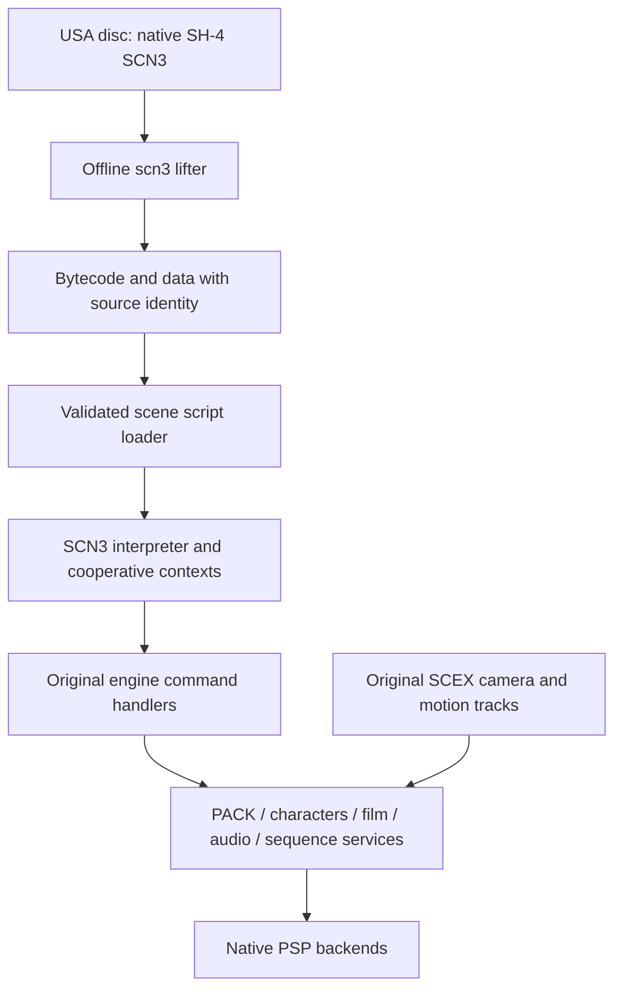

# Scenario VM investigation for PSP

Status: 4 November 2026. Source inspection and compiler layout probes; no VM execution on PSP was validated by this investigation. Runtime source and game behaviour were not changed.

## Decision and scope

Use the USA Dreamcast scenario as the source of behaviour. Convert its native SH-4 SCN3 offline to the existing SCN3 bytecode, then execute that bytecode with a corrected PSP-compatible implementation of the existing interpreter and command interface. The interpreter is reusable machinery, but its current runtime layout and scheduler are not ready for this connection.

The useful boundary for this investigation is **understanding the execution contract and the blockers to running OP02**. That includes loading, addressing, calls, cooperative waits, task lifetime and the subset OP02 uses. Full-game conversion coverage, all command implementations, exact exceptional arithmetic behaviour and performance tuning remain later work.

See [the original intro trace](original-intro-scene.md) for the actual bird/canyon/Shenhua sequence. The currently rendered Ryo is the base player which its original script hides; it is not a reference for the intended scene.

## Architecture to preserve



The SH-4 lifter matches compiled instruction patterns to SCN3 operations. It is not a general SH-4 emulator. It rejects patterns it cannot recognise, remaps function/branch/data addresses and emits relocation records. OP02 conversion succeeds, which establishes a usable input for investigation, not equivalence of every script or correct execution by the current runtime.

Conversion belongs in disc preparation on the host. PSP should load only the current scene's prepared data and runtime state. Do not require PC game assets. Keep source hashes and converter version/profile with derived assets so stale or mismatched conversion can be rejected.

The engine command boundary is the useful common interface for future source variants. A possible later Allegrex code generator should consume the same recovered operations and preserve the same waits, command calls and task ordering. It is not needed to investigate the present blocker. No script CPU budget has been measured, so native compilation cannot yet be justified as a frame-rate requirement.

## Source map

| Responsibility | Source and entry points |
| --- | --- |
| Packed header and runtime declarations | [scen.hpp](../src/s1/task/scen.hpp): `ScenarioHeader`, `ScenarioWindow`, `ScenarioStack`, `ScenarioContext` |
| Module loading | [scen_objects.cpp](../src/s1/task/scen_objects.cpp): `SCN3_Process`, `SCEN_LoadCurrentMapScript` |
| Interpreter and script contexts | [scen_vm.cpp](../src/s1/task/scen_vm.cpp): `Startup_EventBase`, `scenAllocateScntForScript`, `SCN_Parse`, `scenParseByPtr`, `scenParseByPtr2Frames`, `scenParseStackRecursively` |
| Per-frame scheduler and dispatch | [scen.cpp](../src/s1/task/scen.cpp): `SCEN_Callback`, `ExecuteShenmueScriptFn`, `ExecuteSCNFScriptFn` |
| Command indices | [scenario_dispatch.def](../src/s1/task/scenario_dispatch.def) |
| Argument layouts and pointer access | [scen_internal.hpp](../src/s1/task/scen_internal.hpp): `ScriptArguments`, `ScenarioPointer`, parameter structs |
| Spawn, wait, pack commands | [scen_commands_system.cpp](../src/s1/task/scen_commands_system.cpp): `Script_CreateScenarioTask`, `SCNF_WaitFrames`, `Script_EV_PAK_AFS_Utils` |
| Original camera/motion timeline | [scenario_sequence.cpp](../src/s1/task/scenario_sequence.cpp): `ASEQ_InitCameraTrackPointers`, `SEQ_ParseInternal`, `SEQ_ParseFrame` |
| Arena-relative pointers | [hlib_memory.cpp](../src/s1/hlib_memory.cpp): `HLib_GetTaskDataOffset` |
| Bytecode definitions | [isa.def](../tools/scn3/bytecode/isa.def), [isa.hpp](../tools/scn3/bytecode/isa.hpp) |
| Native conversion | [lift.cpp](../tools/scn3/sh4/lift.cpp), [translate.cpp](../tools/scn3/sh4/translate.cpp) |

These describe the current reimplementation. They are not independent proof of the original Dreamcast's semantics. A compiler and interpreter sharing the same mistaken definition can agree with each other.

## Module format and loading

`ScenarioHeader` is twelve 32-bit words, size `0x30`, independent of host pointer size:

| Offset | Field / current use |
| --- | --- |
| `0x00` | `token` (`SCN3`) |
| `0x04` | `wholeSize` |
| `0x08` | `flags`; lifter emits `0x100`, native SH-4 input uses `0x20000` |
| `0x0c` | `functionOffset`: startup function |
| `0x10` / `0x14` | `dataSegmentOffset` / `dataEndOffset` |
| `0x18` | `workspaceSize`; a field to investigate, not the runtime's current allocation size |
| `0x1c` | `unknownOffset` |
| `0x20` | `entrypoint`; distinct from the startup function |
| `0x24` | `relocationTableOffset` |
| `0x28` / `0x2c` | Remaining header words |

`SCEN_LoadCurrentMapScript` frees old contexts and the owned module, then reads `scenario/act%02d_AREA.scn`. It checks some offsets against the header's own `wholeSize`, publishes the module to `Startup_EventBase`, and returns true even if startup returns no live context. The supplied USA disc has no separate PC scenario file: OP02's SCN3 is inside MAPINFO.

`Startup_EventBase` sets `info`, `activeInfo`, `functionInfo`, `dataSegment` and `entrypoint`, allocates a root context at `functionOffset`, and immediately attempts to execute it. Subsequent frames use `SCEN_Callback`.

`scenParseByPtr` only interprets when `flags & 0x00ff0000` is zero. Supplying the native SH-4 chunk does not activate a native execution backend here. The converted VM encoding is required.

Before integration, loading must validate against the **actual allocation/file length**, check the encoding, distinguish startup failure from normal completion, and establish ownership of mutable script data. The header's declared length alone is insufficient.

### Relocations remain an open loader contract

The lifter emits code (`0x2402`) and data (`0x1402`) relocation records. The inspected S1 scenario loader and startup path do not consume `relocationTableOffset`. OP02's lifted module contains one data relocation: site `0x1298` contains module offset `0x136a`.

Establish how these embedded pointer values should become runtime VM addresses before applying relocations. Do not blindly rebase integer words or apply the same adjustment twice. Direct relative-address instructions and pointers stored inside data are different cases. A successful disassembly does not settle this contract.

**Repair status (implemented).** `ScenValidateModule` / `ScenApplyModuleRelocations` consume the 8-byte `{kind, site}` records (`0x2402` code, `0x1402` data, `{0,0}` terminator). The loader reads the actual size with `shenOpenFile`, validates the token, profile, header offsets, sites and targets, then converts each stored module offset with `HLib_GetTaskDataOffset(module) + target`. A relocated module no longer validates, so a second application is rejected rather than double-rebased. OP02's single data record (`0x1298 -> 0x136a`) is covered by `tools/dc/scen_lifetime_test.cpp`. The category-4/8 address forms remain unexercised by OP02 and are left as-is.

## Execution model

### Values and instructions

The VM works on 32-bit words. A word can represent an integer, float bits, actor identifier or VM address; C++ pointer size must not change the script argument ABI.

The instruction byte has three implemented classes:

- `0x00..0x3f`: control, branches and native-command dispatch. The low nibble selects the operation.
- `0x40..0x7f`: literal/address/load operations. The low nibble selects base and access width.
- `0x80..0xbf`: ALU operations selected by the low six bits.

For control/address instructions, bits 4–5 select an immediate width of 0, 1, 2 or 4 bytes. Width zero reuses the previous operand; it does not mean an immediate value of zero. One- and two-byte immediates are read as signed values. That operand state must survive suspension correctly.

ALU operations include signed comparisons, wrapping word addition/subtraction/multiplication, bit operations, signed division/remainder, and float arithmetic/conversions. Comparison results use `0xffffffff` for true and zero for false. Division by zero and signed minimum divided by -1 currently fault the context. Exact exceptional float and overflow behaviour is not established against Dreamcast.

Unknown/reserved operations currently often fall through as no-ops. This can conceal decoder errors. Bringup should diagnose unsupported instructions explicitly, with module and instruction offsets. An instruction watchdog should report a fault, not silently introduce new frame yields into original scripts.

### Calls and memory

The operand stack grows downward in a workspace shared by contexts in one `ScenarioWindow`. Native C++ fields retain each context's instruction pointer, stack pointer, frame pointer, accumulator and previous operand. Only the active context's stack is restored into the shared workspace; suspended contexts retain a saved portion in their own allocation.

A local call pushes a VM return address and previous frame address. A return restores them; a zero previous frame marks context completion. Relative branches change the instruction pointer after reading their operand; local calls/jumps resolve against the active module. An indirect call consumes a VM address.

The principal pointer convention is a 32-bit displacement from `g_pCurrentTaskData`, encoded by `HLib_GetTaskDataOffset` and decoded by `ScenarioPointer` / `PointerFromOffset`. This is an engine arena base, not the current script file or CPU stack. Relative literal instructions resolve a module-relative address and then encode it for the VM.

There are unresolved inconsistencies outside OP02's immediate instruction subset: the runtime's address category 4 uses `workspace`, although the tool names it `script_data`; its address-form pushes a raw host address, while other address forms encode arena offsets. Reconcile these against the original implementation before enabling scripts that use them. Preserve null, signed displacement and alignment behaviour explicitly.

The existing checks are incomplete: several indirect loads/stores only test for non-null pointers, and stack checks accept the entire window object rather than the intended stack range. Header fields and unrelated state therefore sit inside the accepted range. Define the stack bounds and the valid memory domains instead of treating the whole window as a stack.

### Engine command ABI

Calls use five dispatch families: Legacy, general-purpose helpers, Shenmue game commands, paired SCNF asynchronous commands, and door commands. `ExecuteShenmueScriptFn` passes a context plus a pointer to 32-bit argument words; handlers return through `context->stack->accumulator`.

For example, `CreateScenarioTaskParameters` is a function-offset word, an argument-count word, then argument words. `Script_CreateScenarioTask` resolves the function pointer and inserts a new VM context immediately after the parent in the same window's list. This is a cooperative script context, not a new PSP OS thread.

`EventPackAfsParameters` is five words: mode, operation and three further operands. Strings and resource handles are resolved using the VM pointer convention. Preserve command indices, word ordering, float bit patterns and return conventions. Reuse the existing handlers; their presence in the dispatch table alone does not establish their Dreamcast ABI correctness.

### Waits, scheduling and lifetime

`SCEN_Callback` advances script contexts, then the scenario services and `SEQ_ParseFrame`, subject to its existing frame/debug gates. `SCEX` timeline execution is a separate native engine service started by script commands; it is not interpreted SH-4 or VM arithmetic for every camera keyframe.

SCNF public index `n` selects a begin callback at `2*n` and an update callback at `2*n+1`. Arguments are copied into retained context storage. The begin path tests completion bit `0x10000`; the resume path requires the update result to equal `0x10000` before continuing bytecode. That distinction is part of the current implementation and needs verification rather than accidental simplification.

For `WaitFrames`, both slots 0 and 1 use `SCNF_WaitFrames`: decrement the stored counter and complete when its previous value was zero. A call with 1 yields at begin and resumes on its next eligible update. A call with 0 completes immediately. The VM may consume the following stack-cleanup instruction before suspension. Test that cleanup and live local variables survive the wait.

Children are inserted after their parent, so list traversal can reach them in the same scheduler pass. Preserve intended ordering when fixing deletion; arbitrary deferral by a frame can alter pack loading and intro timing.

## Confirmed source hazards before OP02 integration

### 1. PSP layout disagrees with fixed stack arithmetic

Compiled the current declarations with host `g++` and `psp-g++`, then inspected constants in the resulting objects. These are measurements of the checked-out source, not inferred Dreamcast layouts:

| Item | x86-64 host | PSP |
| --- | ---: | ---: |
| Pointer size | `0x8` | `0x4` |
| `sizeof(ScenarioHeader)` | `0x30` | `0x30` |
| `sizeof(ScenarioStack)` | `0x22c` | `0x220` |
| Stack accumulator offset | `0x18` | `0x0c` |
| Stack `frame` offset | `0x1c` | `0x10` |
| Stack `previousOperand` offset | `0x228` | `0x21c` |
| `sizeof(ScenarioWindow)` | `0x2658` | `0x260c` |
| Window `activeInfo` offset | `0x28` | `0x18` |
| Window `dataSegment` offset | `0x58` | `0x34` |
| Window `workspace` offset | `0xd8` | `0x8c` |
| Saved-stack copy end, computed from `frame + 56 + 128*4` | `0x254` | `0x248` |

Consequences directly visible in the source:

- VM stack construction uses `window + 2436*4` (`0x2610`) for a zero-argument interpreted context; restore uses `window + 0x2618`. Both exceed the PSP window's `0x260c` size. The restore memcpy can write beyond the declared object before the interpreter's own range checks run.
- Initial saved arguments/return words use fixed context offsets `0x250` / `0x24c`. Restore uses an endpoint derived from `frame`, which shifts by 12 bytes on PSP. The initializer and restorer disagree.
- `NextStack` is at `frame + 4`: `0x20` on x86-64 but `0x14` on PSP. `Script_srchControl` follows the list using fixed `0x20`.
- Context allocations are 600 bytes (`0x258`), larger than `sizeof(ScenarioStack)` on both targets. Several fields and copies intentionally use the raw allocation's tail. Replacing every constant with `sizeof` would not repair the underlying layout contract.

The PSP build force-includes [psp_abi_compat.hpp](../src/psp/psp_abi_compat.hpp), which disables `static_assert`. It suppresses the original PC layout assertions; it does not adapt the fixed offsets. VM-specific invariants must be checked in a build path where assertions actually execute at compile time.

Recommended repair: make the context header, continuation state, retained async arguments and saved VM words explicit; derive accesses from the chosen representation consistently. Retain 32-bit script words while allowing native implementation pointers to vary. Audit all accesses to these structures together, including command helpers and teardown. Do not add padding solely to silence one symptom without accounting for the full contract.

**Repair status (implemented).** `ScenarioStack` is now an explicit fixed-width context header: `accumulator`, `status`, `asyncFunctionIndex`, `previousOperand`, `trailingFlags`, `asyncArguments[136]` and `savedWords[128]` have host-independent offsets, followed by a naturally aligned native pointer tail (`instruction`, `stackPointer`, `framePointer`, `nextStack`). The VM stack top is workspace-relative (`kScenarioVmStackTopOffset` / `kScenarioVmStackRestoreEndOffset`), so it no longer overruns the PSP window. `tools/dc/scen_layout_probe.cpp` asserts the 32-bit offsets in a translation unit where `psp_abi_compat.hpp` cannot suppress them; `tools/dc/scen_lifetime_test.cpp` covers reaping and child insertion. The measurements above are the pre-repair baseline.

### 2. Completed contexts remain in use after deletion

In `scenParseByPtr`, the cleanup loop can free `activeStack`, after which `activeWordCount`, the save operation and the return expression still access that context. `scenParseStackRecursively` subsequently obtains `NextStack(*stack)` even when the called parser has freed that stack.

This is a statically visible use-after-free path on normal context completion, not a PSP-only layout issue. Allocator memory remaining readable can mask it. Establish safe ownership and iteration before executing the root script, which creates a child and returns. Preserve child scheduling order while repairing lifetime.

**Repair status (implemented).** `scenParseByPtr` now only parses and saves; `scenCollectCompletedStacks` reaps completed contexts after the scheduler pass. `scenParseStackRecursively` re-reads the successor after each parse so children inserted during the pass are still visited. Covered by `tools/dc/scen_lifetime_test.cpp`.

### 3. Module/pointer correctness is not yet established

The loader lacks an actual-file-length contract; relocation consumption is absent from the inspected path; the pointer encoding has inconsistent cases; and the interpreter conflates failure with normal completion by setting the same finished bit. Add a diagnostic result that distinguishes completed, waiting and faulted contexts before using visual output as an execution test.

**Repair status (implemented).** `SCEN_LoadCurrentMapScript` now validates against the actual `shenOpenFile` size and rejects truncated, native-profile, wrong-token, bad-layout and bad-relocation modules. `scenParseByPtr` and `SCN_Parse` set `kScenarioContextFinished | kScenarioContextFaulted` on failure while normal completion sets only `Finished`; `SCEN_GetVmFaultCount` exposes the fault count. The category-4/8 address forms are not used by OP02, so their reconciliation is deferred to the first script that needs them.

## A bounded OP02 implementation and validation plan

The lifted OP02 disassembly contains **1,675 static instruction records, 26 distinct operation mnemonics, 41 distinct Shenmue command handlers, and only one SCNF primitive: `WaitFrames`**. These are static coverage counts, not runtime dispatch counts or performance measurements.

Its VM subset uses immediate and module-relative addresses, frame-local addresses/16- and 32-bit loads, word/halfword stores, local calls/returns, conditional/relative branches, stack adjustment, operand latching, game calls and waits. Arithmetic is integer comparisons/bit-and/add/multiply/divide plus float addition. It does not need a complete audit of every reserved opcode, door command or dialogue system to begin.

Work in this order:

1. **Fix and exercise context layout and lifetime in isolation.** Use small bytecode fixtures with instrumented commands. Cover root return, child creation with arguments, parent return with a live child, nested calls across a wait, sibling waits, and canaries around stack storage. Run a host memory-safety build and an actual 32-bit PSP probe; the host alone cannot validate this port.
2. **Establish module and pointer handling.** Reject truncated/native/wrong-profile modules, validate branches and relocation sites, test relative strings/function pointers and data pointers, and verify live mutable data across waits. Use independent expected results, not only compiler/interpreter round trips.
3. **Validate OP02's execution contract without full rendering.** Record module-relative instruction positions, script context identity, frame, command index, typed argument values, returns and waits. Check pack readiness polling, HAWK/SINF creation, original Ryo-hide commands, sequence order `0,1,2,3,6,4,5`, normal Display return and Start skip against the recovered trace. This is a test harness, not a replacement production scene controller.
4. **Connect the prepared original module to the real engine.** Exercise the normal title-idle handoff. Pack loading, actors, dynamic maps and sequence commands must drive the native PSP backends through the existing services. Diagnose those service failures separately from VM failures.
5. **Measure script time and memory once it executes.** Count active contexts, peak saved words, dispatches and VM CPU time separately from engine-command time. Load and release scene modules predictably. Use this evidence to decide whether interpreter optimisation or an Allegrex backend is warranted.

Initial acceptance requires correct command/argument/frame ordering, surviving wait/resume state, safe context cleanup and clean return to the title controller. A converted file, a visible placeholder or a successful build is insufficient.

## Evidence and reproduction

The existing [intro audit](../tools/dc/intro_scene.py) reconstructs the input evidence:

```
python3 -B tools/dc/intro_scene.py USA/DISC1/extracted \
  --output build/dc-menu-audit/intro-usa \
  --scn3cc /tmp/opencode/scn3build/scn3cc
```

The compiler path is the prepared investigation tool from the handoff, not an installation requirement for end users. Production disc preparation will need a reproducible tool build.

Observed OP02 VM header: size `0x137c`, flags `0x100`, startup `0xf33`, code start/entrypoint `0x30`, data start `0x1094`, data end/relocation table `0x136c`, workspace field 0. The native input is 10,252 bytes and output 4,988 bytes.

Local evidence from this investigation lives in `build/dc-menu-audit/vm-investigation/`: `layout.cpp`, host/PSP object files and `.rodata` dumps, and `op02-coverage.json`. The layout probe includes the actual `scen.hpp`, emits `sizeof`/`offsetof` values and compares them across compilers; it does not execute the VM. To recreate `layout.cpp` in a fresh checkout (create the build directory first):

```cpp
#include "s1/task/scen.hpp"
#include <cstddef>
#include <cstdint>
using namespace shenmue::s1;
extern "C" const std::uint32_t vm_layout[] = {
    sizeof(void*), sizeof(ScenarioHeader), sizeof(ScenarioStack),
    offsetof(ScenarioStack, accumulator), offsetof(ScenarioStack, status),
    offsetof(ScenarioStack, previousOperand), offsetof(ScenarioStack, trailingFlags),
    sizeof(ScenarioWindow), offsetof(ScenarioWindow, stacks),
    offsetof(ScenarioWindow, activeInfo), offsetof(ScenarioWindow, dataSegment),
    offsetof(ScenarioWindow, entrypoint), offsetof(ScenarioWindow, workspace),
    offsetof(ScenarioStack, savedWords) + 4 * kScenarioSavedWordCount
};
```

Example PSP invocation:

```
psp-g++ -std=c++20 -DSHENMUE_HOST_PSP \
  -include src/psp/psp_abi_compat.hpp \
  -Isrc -Ithird_party/nuklear -Ilibs/ShenmueDK/include \
  -c build/dc-menu-audit/vm-investigation/layout.cpp \
  -o build/dc-menu-audit/vm-investigation/layout-psp.o
psp-objdump -s -j .rodata build/dc-menu-audit/vm-investigation/layout-psp.o
```

## Stop boundary and remaining questions

The VM is understood well enough to identify a focused repair target and validate OP02. This document stops before implementing those repairs or claiming a complete VM specification.

Still unresolved: original semantics of script-data/scenario-work address forms, relocation application, complete local/async argument storage limits, every command's ABI, exceptional numeric behaviour, native variants outside the lifter's patterns, all-USA conversion coverage, and original scheduler edge cases during cancellation or scene teardown. Dialogue, free-talk and door-specific scenario machinery also remain outside this stage. These should be investigated when required by the next scene or by evidence from the focused tests, rather than expanding this document into a whole-game reverse-engineering project.
